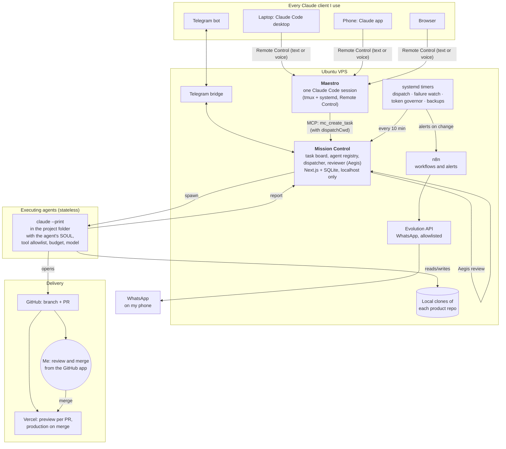

# Architecture

## The picture

## Components

| Component | What it is | Mine or upstream |
|---|---|---|
| **Maestro** | A single Claude Code session running on the server under systemd + tmux, started with `--remote-control`. Every client attaches to it, so there is one context, one memory, one set of permissions. Its `CLAUDE.md` holds the operating rules (how to write cards, the `dispatchCwd` rule, what never to delegate). | Mine |
| **Mission Control** | Self-hosted control plane for AI agents: task board, agent registry with SOULs, dispatcher that spawns `claude --print`, built-in reviewer (Aegis), token tracking, MCP server. | Upstream open source ([builderz-labs/mission-control](https://github.com/builderz-labs/mission-control)), run from [my fork](https://github.com/rica-amaral/mission-control) with ~70 commits of changes, listed in [docs/fork-changes.md](docs/fork-changes.md) |
| **Agent SOULs** | The system prompt, tool allowlist, budget and model of each agent. | Mine ([agents/](agents/)) |
| **Ops scripts** | Dispatch trigger, failure watch, token governor. | Mine ([ops/](ops/)) |
| **Cost report** | Reads Mission Control's SQLite and prints usage by model and week, plus delivery outcomes. | Mine ([tools/cost_report.py](tools/cost_report.py)) |
| **n8n** | Workflows: WhatsApp routing, ERP sync, alerts coming from the ops scripts. | Upstream, my workflows |
| **Evolution API** | WhatsApp gateway, reachable only from n8n, inbound restricted by an allowlist. | Upstream |
| **Telegram bridge** | Small Node service: messages to a bot become requests to Mission Control, results come back to the chat. Only allowlisted chats are accepted. | Mine (not published: it is mostly allowlist and chat plumbing) |
| **Private network** | A mesh VPN connects the laptop, an office PC, a Raspberry Pi at the workshop and the server. Mission Control is never exposed to the internet. | Upstream |

## One request, step by step

1. I describe a need to the Maestro (typed or voice) from whatever device is in my hand.
2. The Maestro identifies the project with `mc_list_projects` (the slug is the folder name),
   splits the work into cards that each fit one short non-interactive run, and creates them with
   `mc_create_task`, always with `metadata.dispatchCwd`. See
   [skills/writing-agent-cards](skills/writing-agent-cards/SKILL.md) and a real card in
   [specs/example-feature.md](specs/example-feature.md).
3. Every 10 minutes the dispatch timer fires. Mission Control picks assigned tasks, refuses any
   without a repository owner, resets the clone to the current main, and spawns `claude --print` in
   that folder with the agent's SOUL as system prompt and its tool allowlist and budget.
4. The agent works, runs the project's own build and lint, pushes a `feat/mc-*` branch and opens a
   PR. Its final report becomes the task comment.
5. Aegis reviews the delivery. A rejection sends the task back with the reason; the agent continues
   on the same PR.
6. Vercel builds a preview for the PR. I review and merge from the GitHub app on my phone.
   Production changes only on merge.
7. If the change has a database migration, the Maestro applies it right after the merge.
8. Progress and failures reach me on WhatsApp or Telegram. The failure watch only speaks when
   something changes.

## Decisions worth explaining

**One orchestrator instead of one assistant per device.** Before this, the laptop, the work PC,
the phone and the server each had their own Claude with different context, permissions and output
format. The same request was done four different ways. Moving the single session to the server
fixed availability (the laptop sleeping no longer stops work) and consistency at the same time.

**The pull request is the human gate.** Agents can do almost anything inside a branch. What they
cannot do is reach production: only a merge does that, and only I merge. Reviewing a diff with a
live preview from a phone takes a minute, so the gate is cheap enough to keep on every change.

**The task carries the project, not the agent.** Agents are not dedicated to a repository. That
keeps the fleet small (one `dev`, one `qa`) but makes the card the only source of truth for
where to work. Three layers protect it: the Maestro's rule, the agent's `pwd` check, and the
dispatcher refusing cards with no owner.

**Diagnosis is not an agent.** The failure watch and the token governor are plain scripts. They
need to be cheap, deterministic, and trustworthy enough that I act on their messages.

**Timers instead of the built-in scheduler.** Mission Control's internal scheduler is registered
but never started. A systemd timer survives restarts and rebuilds and shows up next to every other
routine.

## What changed since the case study

The case study lists a Paperclip agent orchestrator in a container. It was retired on 2026-10-19,
when every client was consolidated onto the single Maestro session. Its configuration is kept as
a backup only.
